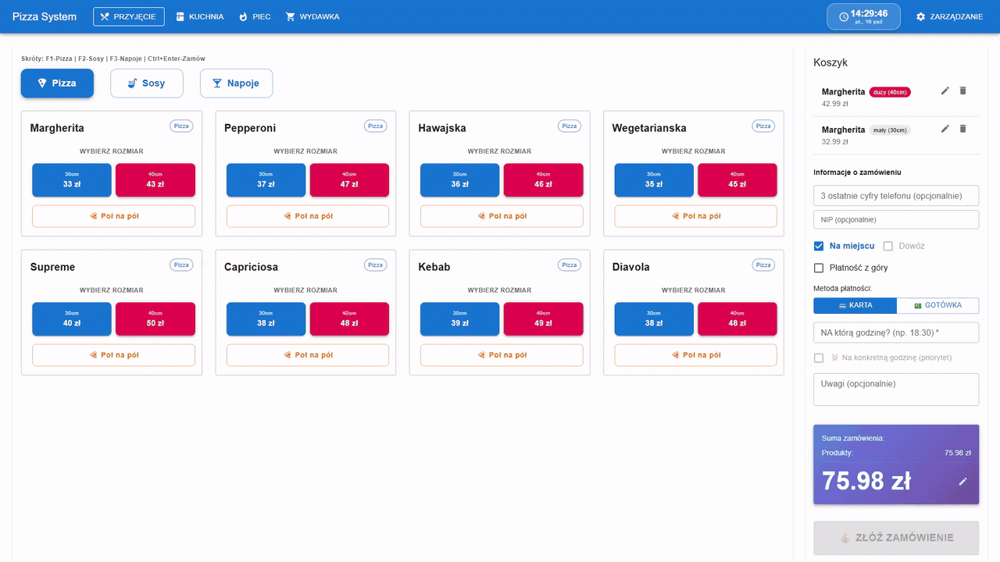
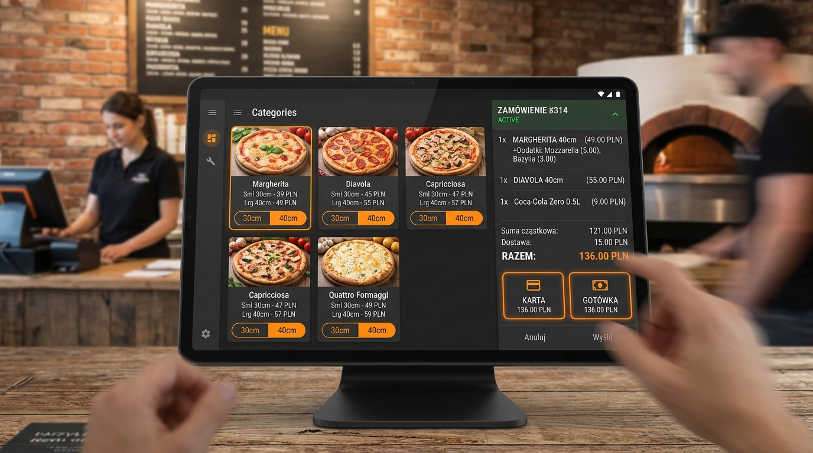
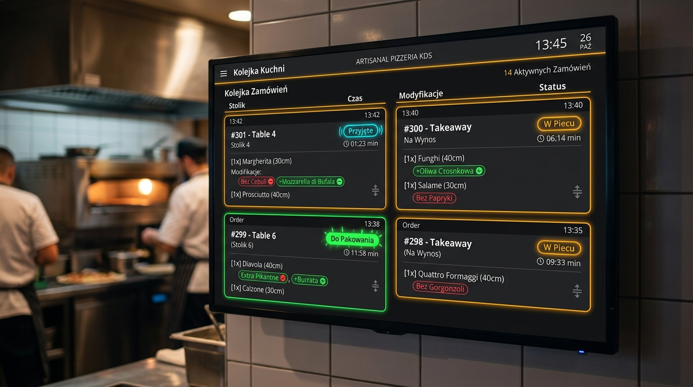
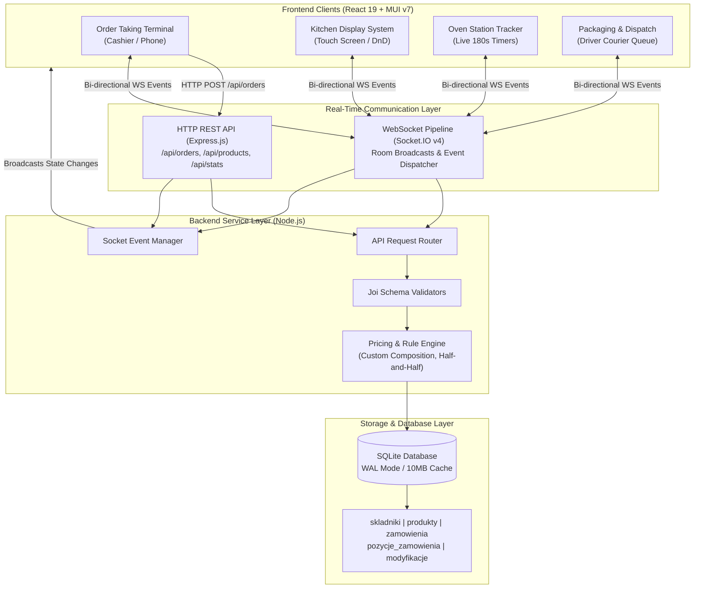
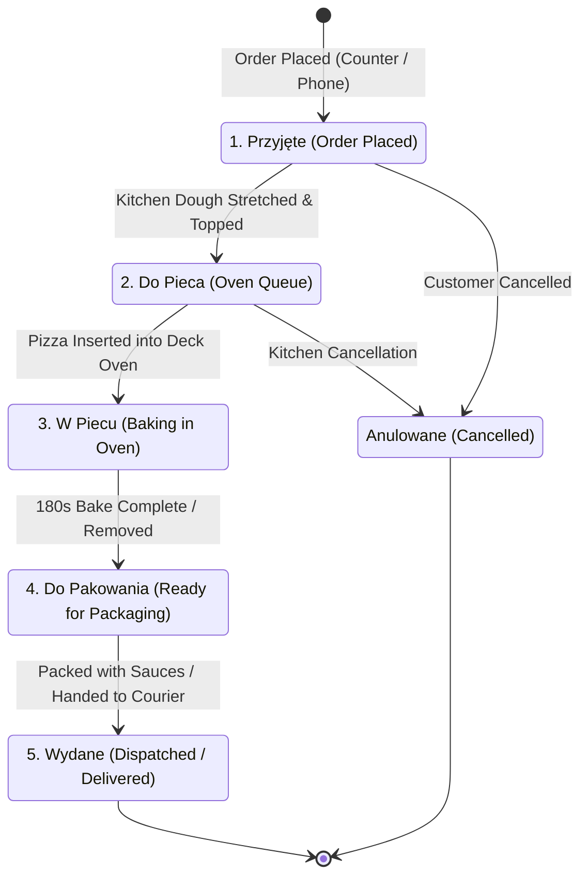
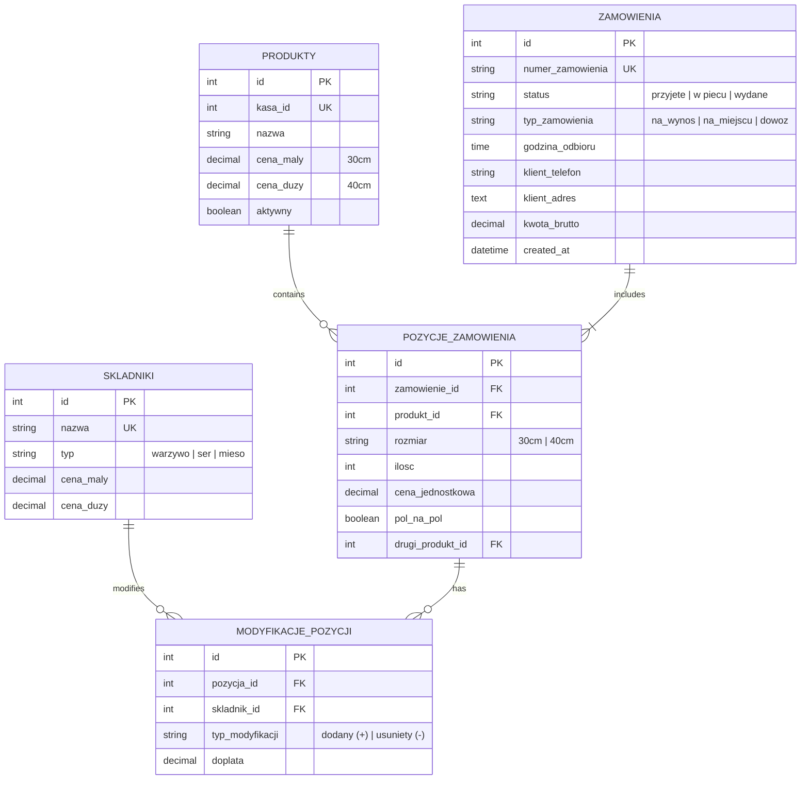

# POS Pizzeria

### Modern Real-Time Point of Sale & Kitchen Display System (KDS) for Artisanal Pizzerias

 

**[🇵🇱 Przejdź do polskiej wersji (Polish README)](README.pl.md)**

  

  
  
<em>Real-Time Pizzeria Pipeline: Waiter Cashier POS Terminal ➔ Kitchen KDS Queue ➔ Multi-Deck Oven Tracking</em>

> [!NOTE]
> ### 🏛️ System Showcase & Architecture Overview
> This repository serves as a **portfolio and architectural showcase** containing high-level system designs, database schemas, interactive visual previews, configuration models, and engineering specifications.
> Full commercial production source code is available to technical recruiters upon request (see below).

---

## 📌 Executive Summary

**POS Pizzeria** is an end-to-end, high-throughput Point of Sale and Kitchen Display System engineered specifically for fast-paced Italian pizzerias and high-volume delivery restaurants.

Traditional restaurant POS solutions struggle with the unique complexities of pizza operations: split half-and-half compositions, granular ingredient additions/subtractions, dynamic multi-tier pricing, and strict oven timing synchronization. 

This platform bridges order creation at the front counter with real-time WebSocket event dispatching to dedicated touch interfaces:
1. **Cashier / Waiter Order Terminal (`/`)**: Lightning-fast order builder with custom ingredient matrices, size toggles, custom composition calculators, and delivery address parsing.
2. **Kitchen Display System KDS (`/kuchnia`)**: Drag-and-drop order queue with visual timers, color-coded modifier pills, and multi-station staging.
3. **Oven Station Tracker (`/piec`)**: Precise live baking countdowns (3:00 min targets) with delayed-bake warnings and oven deck occupancy.
4. **Packing & Driver Dispatch (`/pakowanie`)**: Real-time consolidation of baked orders, thermal bag staging, customer delivery routing, and payment verification.

---

## 📸 Platform Previews & Visual Showcase

### 1. 🍕 Touch Cashier POS Terminal (`/`)
High-speed ordering terminal designed for rapid counter transactions and phone deliveries.
Features categorized visual pizza cards, instant ingredient modification dialogs, half-and-half pizza builder (40cm), and live recalculation of discounts, delivery charges, and sauce pricing.

  

 

### 2. 👨‍🍳 Kitchen Display System (KDS) & Real-Time Queue (`/kuchnia`)
Mounted kitchen touchscreen replacing paper printer tickets with synchronized digital order cards.
Features drag-and-drop prioritization via `@dnd-kit`, color-coded ingredient modification tags (+green added / -red removed), preparation elapsed timers, and single-tap handoff to the oven.

  

---

## 🚀 Key Features & Domain Engine

### 1. 🍕 Complex Pizza Domain Pricing Engine
- **Granular Size Matrix**: Seamless toggle between small (30cm) and large (40cm) variants with automated price delta calculations.
- **Custom Composition Engine ("Własna Kompozycja")**: First 5 ingredients are included free of charge; subsequent additions automatically billed according to size matrix (4 PLN small / 5 PLN large).
- **Half-and-Half Builder ("Pół na Pół")**: Enables combining two distinct specialty pizzas on a single 40cm crust, splitting ingredient lists while applying fair pricing heuristics.
- **Free Toppings Whitelist**: Zero-charge condiments (Tabasco, fresh arugula, black pepper) tracked separately from premium cheeses and meats.

### 2. ⚡ Real-Time WebSocket Architecture (Socket.IO)
- Zero-latency broadcast of order state transitions (`order:created`, `order:status_changed`, `order:updated`, `order:priority_moved`).
- Bidirectional updates: Moving an order card in the kitchen instantly updates the cashier terminal and oven monitors across all network tablets.
- Resilient auto-reconnect with state synchronization on reconnection.

### 3. 🔥 Oven Station with Live Timers
- Dedicated visual countdown bar per pizza item (180s target).
- Audio/visual flashing alerts when pizzas exceed warning thresholds (210s), preventing burnt dough during peak dinner rushes.
- Chronological and table priority sorting.

### 4. 🗄️ Database Concurrency & Performance
- SQLite database configured with **WAL (Write-Ahead Logging)** mode for concurrent multi-client read operations during heavy write loads.
- Tuned PRAGMA settings: `cache_size = -10000` (10MB in-memory buffer), `synchronous = NORMAL`, and `busy_timeout = 30000` to eliminate database locking issues.

---

## 🏛️ System Architecture

---

## 🔄 Order Lifecycle State Machine

---

## 🗄️ Relational Database Schema

---

## 🛠️ Tech Stack & Key Dependencies

| Component | Technology | Version | Purpose |
|---|---|---|---|
| **Frontend Framework** | React | `^19.2.0` | High-performance reactive UI rendering |
| **Component Library** | Material-UI (MUI) | `^7.3.4` | Dark theme restaurant UI components & icons |
| **Drag & Drop** | `@dnd-kit/core` | `^6.3.1` | Kitchen ticket reordering on touch screens |
| **Routing** | React Router DOM | `^7.9.4` | Single-page multi-station client routing |
| **API Client** | Axios | `^1.12.2` | REST API HTTP communication |
| **Backend Runtime** | Node.js | `20+ LTS` | Server-side JavaScript runtime |
| **HTTP Framework** | Express.js | `^4.21.0` | REST API routes & middleware |
| **Real-time Engine** | Socket.IO | `^4.8.1` | Instant event propagation across tablets |
| **Embedded Database** | SQLite (`sqlite3`) | `^5.1.7` | Zero-configuration WAL database storage |
| **Validation** | Joi | `^17.13.0` | Payload verification for orders and products |
| **Logging** | Winston & Morgan | `^3.17.0` | Audit logging and request tracing |

---

## 💼 Informacja dla Rekruterów / Recruiter Notice

> **Pełny kod źródłowy projekt dostępny do wglądu dla rekruterów na życzenie po kontakcie mailowym.**
> 
> The complete production source code, commit history, and technical documentation are available for recruiters and hiring managers upon request:
> - 📬 **E-mail**: [dominikzatorski8@gmail.com](mailto:dominikzatorski8@gmail.com)
> - 💼 **LinkedIn**: [Dominik Zatorski](https://pl.linkedin.com/in/dominik-zatorski-b1a82a1b9)
> - 🐙 **GitHub Profile**: [@verblo](https://github.com/verblo)

---

## 👨‍💻 Author & Contact

**Dominik Zatorski**
- GitHub: [@verblo](https://github.com/verblo)
- LinkedIn: [Dominik Zatorski](https://pl.linkedin.com/in/dominik-zatorski-b1a82a1b9)
- Email: [dominikzatorski8@gmail.com](mailto:dominikzatorski8@gmail.com)

---

## 📄 License

This project is licensed under the [MIT License](LICENSE) — free to use and adapt.
