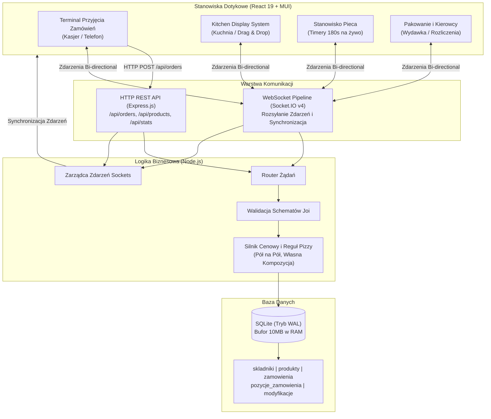

# POS Pizzeria

### Nowoczesny System Point of Sale (POS) oraz Kitchen Display System (KDS) Czasu Rzeczywistego dla Gastronomii

 

**[🇬🇧 Switch to English Version](README.md)**

  

  
  
<em>Przepływ Zamówienia: Terminal Kasjerski ➔ Ekran Kuchni KDS ➔ Timer Pieca ➔ Strefa Pakowania i Kurier</em>

> [!NOTE]
> ### 🏛️ Publiczny Showcase Architektury Projektu
> Niniejsze repozytorium stanowi **portfolio technologiczne i showcase architektoniczny** prezentujący architekturę systemu, model bazy danych, schematy przepływu danych oraz specyfikację techniczną.
> Pełny komercyjny kod źródłowy jest udostępniany do wglądu dla rekruterów na życzenie (szczegóły poniżej).

---

## 📌 Podsumowanie Wykonawcze

**POS Pizzeria** to kompleksowy, wysokowydajny system klasy Point of Sale (POS) oraz Kitchen Display System (KDS), zaprojektowany specjalnie pod specyfikę pizzerii rzemieślniczych oraz lokali o wysokim wolumenie dostaw.

Standardowe systemy gastronomiczne nie radzą sobie z unikalną logiką pizzerii: pizzami łączonymi „pół na pół”, elastycznymi modyfikacjami składników (+dodatki / -zamienniki), wielopoziomowym cennikiem zależnym od rozmiaru ciasta oraz synchronizacją pieca szamotowego w czasie rzeczywistym.

Platforma łączy przyjmowanie zamówień z natychmiastowym rozsyłaniem zdarzeń przez WebSockety (Socket.IO) na dedykowane ekrany dotykowe:
1. **Terminal Kasjera / Kelnera (`/`)**: Szybki kreator zamówień z cennikiem składników, rozmiarami (30cm/40cm), kompozycją własną i dowozami.
2. **Kitchen Display System KDS (`/kuchnia`)**: Kolejka zamówień na ekranie dotykowym z drag & drop (`@dnd-kit`), wskaźnikami czasu i kolorowymi plakietkami modyfikacji składników.
3. **Stanowisko Pieca (`/piec`)**: Licznik pieczenia na żywo (czas docelowy: 3:00 min) z ostrzeżeniami o przekroczeniu czasu.
4. **Pakowanie i Kurierzy (`/pakowanie`)**: Kompletowanie upieczonych dań, weryfikacja płatności, przydział kierowców i wydawka.

---

## 📸 Zrzuty Ekranu i Showcase Wizualny

### 1. 🍕 Terminal Dotykowy Kasjera (`/`)
Błyskawiczne przyjmowanie zamówień stacjonarnych i telefonicznych z podziałem na kategorie, modyfikacjami składników i automatycznym obliczaniem rabatów i opłat za dowóz.

  

 

### 2. 👨‍🍳 Kuchnia KDS & Kolejka Czasu Rzeczywistego (`/kuchnia`)
Cyfrowy system bonowania w kuchni eliminujący papierowe paragony. Posiada drag & drop kart zamówień, oznaczenia modyfikacji składników (+zielony / -czerwony) oraz przekazywanie do pieca jednym dotknięciem.

  

---

## 🚀 Kluczowe Funkcjonalności

- **Silnik kalkulacji cen pizzy**:
  - Obsługa rozmiarów 30cm oraz 40cm.
  - Specjalna reguła **"Własna Kompozycja"**: pierwsze 5 składników za darmo, kolejne rozliczane wg cennika dodatków.
  - Obsługa **"Pół na pół"**: łączenie dwóch różnych pizz na jednym spodzie 40cm.
  - Darmowe dodatki przyprawowe (tabasco, rukola, pieprz).
- **Komunikacja WebSocket w czasie rzeczywistym**:
  - Natychmiastowa synchronizacja wszystkich tabletów i stanowisk bez odświeżania strony.
  - Obsługa zdarzeń `order:created`, `order:status_changed`, `order:priority_moved`.
- **Wydajność bazy danych SQLite**:
  - Tryb **WAL (Write-Ahead Logging)** gwarantujący brak blokad przy jednoczesnym odczycie i zapisie.
  - Zwiększona pamięć podręczna `PRAGMA cache_size = -10000` (10MB bufor w RAM) i timeout `busy_timeout = 30000`.

---

## 🏛️ Architektura Systemu

---

## 💼 Informacja dla Rekruterów

> **Pełny kod źródłowy projekt dostępny do wglądu dla rekruterów na życzenie po kontakcie mailowym.**
> 
> Pełna wersja kodu produkcyjnego, historia commitów oraz dokumentacja wdrożeniowa są udostępniane dla rekruterów i liderów technicznych:
> - 📬 **E-mail**: [dominikzatorski8@gmail.com](mailto:dominikzatorski8@gmail.com)
> - 💼 **LinkedIn**: [Dominik Zatorski](https://pl.linkedin.com/in/dominik-zatorski-b1a82a1b9)
> - 🐙 **Profil GitHub**: [@verblo](https://github.com/verblo)

---

## 👨‍💻 Autor i kontakt

**Dominik Zatorski**
- GitHub: [@verblo](https://github.com/verblo)
- LinkedIn: [Dominik Zatorski](https://pl.linkedin.com/in/dominik-zatorski-b1a82a1b9)
- E-mail: [dominikzatorski8@gmail.com](mailto:dominikzatorski8@gmail.com)

---

## 📄 Licencja

Projekt objęty otwartą licencją [MIT License](LICENSE) — swoboda modyfikacji i zastosowań.
