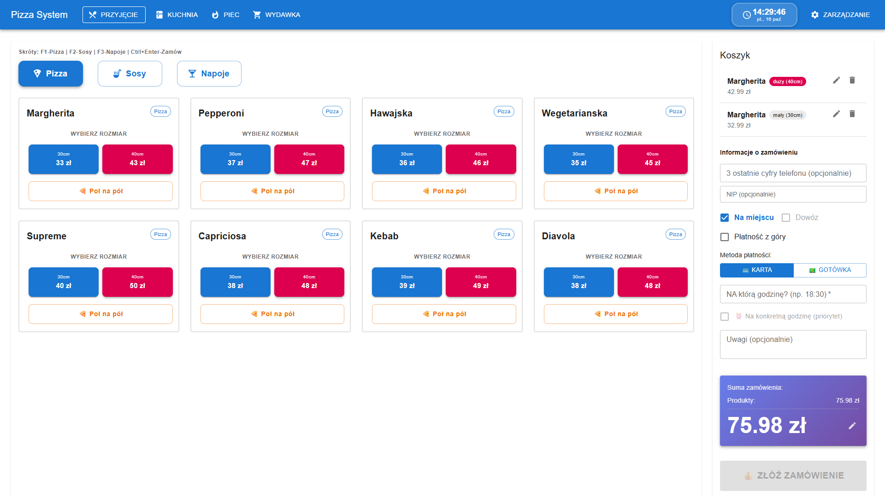
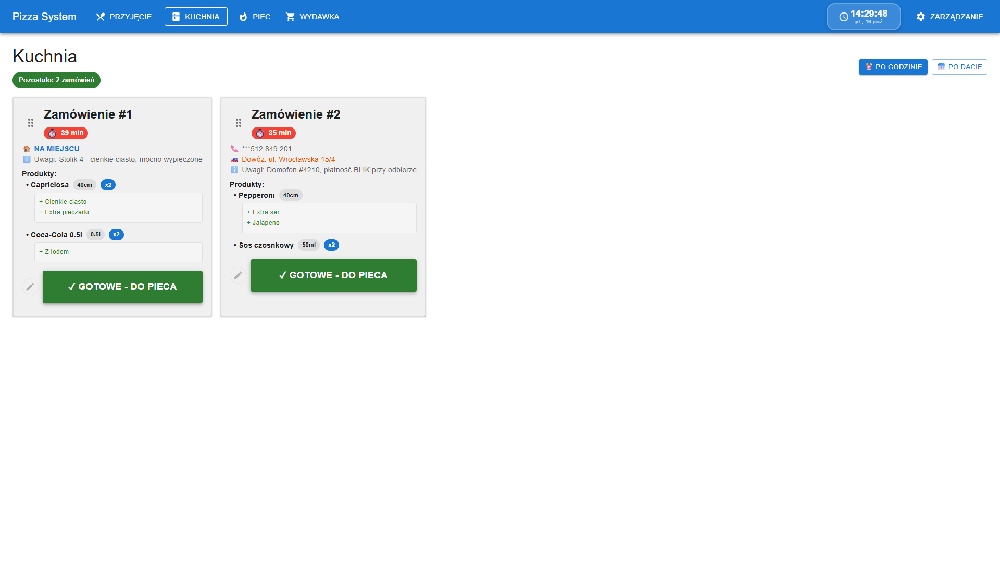
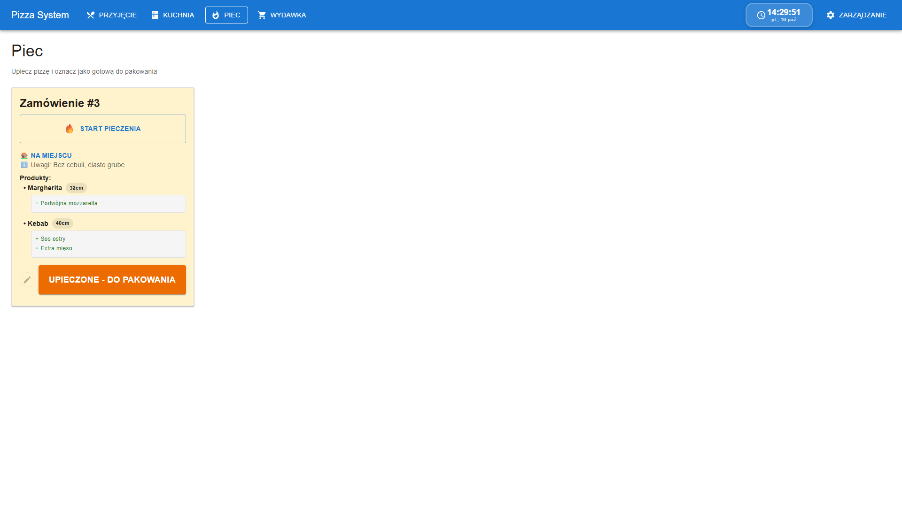
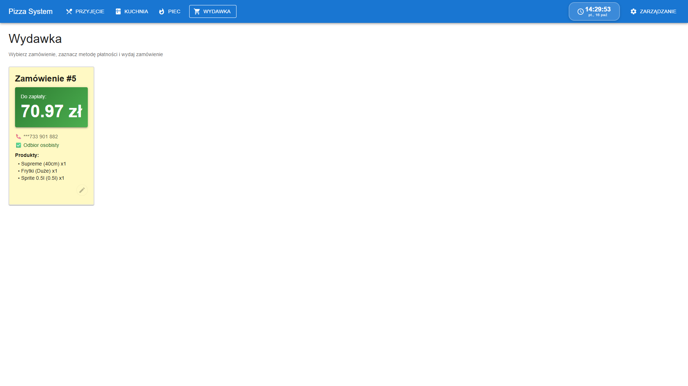
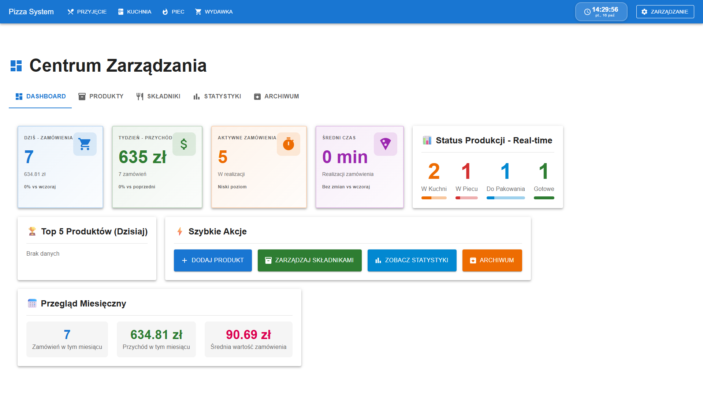
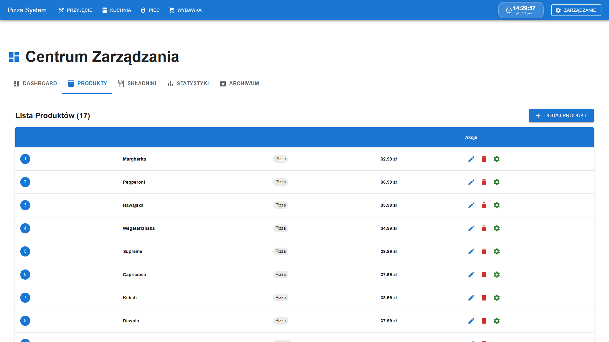

# POS Pizzeria

### Nowoczesny System Real-Time POS i KDS (Kitchen Display System) dla Gastronomii i Pizzerii

 

**[🇬🇧 Switch to English Version](README.md)**

  

  
  
<em>Pełny obieg zamówienia w czasie rzeczywistym: Terminal Kelnerski ➔ KDS Kuchnia ➔ Monitor Pieca ➔ Stacja Wydawki & Kierowcy ➔ Analityka Biznesowa</em>

> [!NOTE]
> ### 💼 Portfolio Showcase i Prezentacja Architektury
> Niniejsze repozytorium stanowi **publiczne portfolio inżynierskie**, prezentujące architekturę, schematy bazodanowe, konfigurację, dokumentację oraz rzeczywiste widoki interfejsu systemu.
> Pełny komercyjny kod źródłowy udostępniany jest dla rekruterów na życzenie po kontakcie mailowym.

---

## 🍕 Podsumowanie Projektu

**POS Pizzeria** to kompleksowy, wysokowydajny system sprzedaży (Point of Sale) oraz monitoringu produkcji kuchennej (Kitchen Display System), stworzony od podstaw z myślą o specyfice restauracji serwujących pizzę i realizujących wysoki wolumen zamówień z dostawą.

W odróżnieniu od generycznych systemów gastronomicznych, platforma perfekcyjnie obsługuje:
- Pizze "Pół na Pół" z niezależnymi kompozycjami i sosami na każdej połowie
- Zaawansowany matrycowy konfigurator składników (dodatki, zamienniki, grubości ciasta)
- Natychmiastową synchronizację WebSocket (sub-10ms) pomiędzy terminalami kelnerskimi, kuchnią a stacją pieca
- Panel wydawki z weryfikacją płatności i przypisywaniem kierowców do rewirów dostaw

---

## 📸 Prezentacja Rzeczywistego Interfejsu

### 1. 🍕 Dotykowy Terminal Kelnerski / Kasa (`/`)
Błyskawiczne przyjmowanie zamówień na sali i przez telefon. Wybór rozmiarów (30cm / 40cm), konfiguracja stolika lub dowozu, podsumowanie koszyka na żywo.

  
  
<em>Rzeczywisty zrzut ekranu: Wybór pizzy Margherita 40cm i 30cm, obsługa stolika na miejscu, natychmiastowe przeliczenie kwoty 75.98 zł.</em>

 

### 2. 👨‍🍳 Kitchen Display System — KDS Kuchnia (`/kuchnia`)
Eliminuje papierowe bloczki. Bilety zamówień pojawiają się w kuchni automatycznie w ułamku sekundy, z licznikami czasu oczekiwania i podświetlonymi modyfikacjami.

  
  
<em>Ekran Kuchni: Oznaczenia priorytetu czasowego, wyszczególnione modyfikacje (+ Cienkie ciasto, + Extra pieczarki) oraz przycisk przekazania 'GOTOWE - DO PIECA'.</em>

 

### 3. 🔥 Stacja Pieca i Kontrola Wypieku (`/piec`)
Synchronizacja wypieku w komorach pieca. Liczniki czasu pieczenia ostrzegają przed przypaleniem ciasta i automatycznie powiadamiają stację pakowania.

  
  
<em>Monitor Pieca: Nadzór nad pieczonymi plackami, przypomnienie o cieście (grube/cienkie) i akcja 'UPIECZONE - DO PAKOWANIA'.</em>

 

### 4. 📦 Wydawka, Odbiór i Obsługa Dostaw (`/wydawka`)
Stacja kompletacji zamówień z zimnymi napojami i sosami. Wyświetla status płatności, adres dowozu, kod do domofonu oraz telefon klienta.

  
  
<em>Ekran Wydawki: Czytelny zielony kafelek z kwotą do pobrania (70.97 zł) oraz weryfikacja pozycji pobieranych z kuchni.</em>

 

### 5. 📊 Centrum Zarządzania, Analityka i Magazyn (`/zarzadzanie`)
Panel menedżerski z kluczowymi wskaźnikami KPI: obrót dzienny (635 zł), statystyki koszyka, wąskie gardła produkcji na żywo oraz edytor menu i stanów magazynowych.

  
  
<em>Dashboard Menedżerski: Bieżące podsumowanie utargu, struktura zamówień (2 w kuchni, 1 w piecu, 1 do pakowania) oraz średnia wartość koszyka.</em>

 

  
  
<em>Katalog Produktów: Poziomy cenowe, przypisanie do kas oraz konfiguracja receptur.</em>

---

## 🛠️ Stos Technologiczny

- **Frontend**: React 19, Material-UI (MUI v7), Emotion, `@dnd-kit/core`
- **Real-Time WebSockets**: Socket.IO Client & Server v4.8
- **Backend**: Node.js v20+, Express.js v5 (HTTP Keep-Alive, optymalizowany JSON payload)
- **Baza Danych**: SQLite3 w trybie WAL (`PRAGMA journal_mode = WAL`), cache 10MB
- **Walidacja i Logi**: Joi, Winston, Morgan

---

## 📄 Adnotacja dla Rekruterów

> ### 📬 Informacja dla Rekruterów
> **Pełny kod źródłowy projekt dostępny do wglądu dla rekruterów na życzenie po kontakcie mailowym.**
>
> ✉️ **Kontakt**: [dominikzatorski8@gmail.com](mailto:dominikzatorski8@gmail.com)  
> 👤 **Autor**: Dominik Zatorski ([@verblo](https://github.com/verblo))
